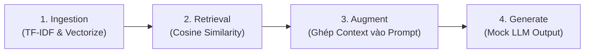

# Demo RAG Tối Giản (Minimal Python RAG)

Dự án minh họa luồng hoạt động cơ bản của kiến trúc **RAG (Retrieval-Augmented Generation)** chỉ bằng thư viện chuẩn của Python (**không cần cài đặt thư viện ngoài**).

---

## 📌 Kiến trúc & Luồng hoạt động

Mã nguồn tại [`1_demo_rag.py`](./1_demo_rag.py) triển khai trọn vẹn 4 giai đoạn của một pipeline RAG:



1. **Ingestion (Xử lý dữ liệu)**:
   * Tách từ (tokenize) và loại bỏ stopwords tiếng Việt.
   * Tính chỉ số IDF (Inverse Document Frequency) và biểu diễn từng đoạn tài liệu dưới dạng vector TF-IDF.
2. **Retrieval (Truy xuất)**:
   * Biểu diễn câu hỏi (query) thành vector TF-IDF.
   * Dùng độ tương đồng Cosine (Cosine Similarity) để xếp hạng và lọc các tài liệu liên quan nhất (`top_k=2`, `min_score=0.15`).
3. **Augment (Bổ sung ngữ cảnh)**:
   * Ghép các đoạn tài liệu tìm được vào khuôn mẫu prompt (Prompt Template) kèm chỉ dẫn trích dẫn nguồn `[docX]` và chống ảo giác (hallucination).
4. **Generate (Sinh câu trả lời)**:
   * Giả lập phản hồi của mô hình ngôn ngữ dựa trên ngữ cảnh được cung cấp.

---

## 🚀 Hướng dẫn chạy

### Yêu cầu
* Python 3.8 trở lên.
* **Không cần `requirements.txt`** do chỉ sử dụng các module có sẵn (`math`, `re`, `collections`).

### Lệnh chạy
Chạy trực tiếp file script:

```bash
python 1_demo_rag.py
```

---

## 💡 Ví dụ kiểm thử trong mã nguồn

File script có sẵn 4 ca kiểm thử để thấy rõ ưu & nhược điểm của RAG dùng TF-IDF:

| Câu hỏi | Kết quả | Ý nghĩa minh họa |
| :--- | :--- | :--- |
| `RAG là kỹ thuật gì?` | Tìm thấy `[doc1]` | Truy xuất từ khóa chính xác |
| `Vì sao dùng RAG thay vì fine-tuning?` | Tìm thấy `[doc4]` | Truy xuất ngữ cảnh đối chiếu |
| `Thủ đô của nước Pháp là gì?` | Từ chối trả lời | Cơ chế phòng ngừa ảo giác khi dữ liệu không có trong kho |
| `Làm sao để AI bớt bịa đặt?` | Không khớp | **Giới hạn của TF-IDF**: Không hiểu được ngữ nghĩa (semantic) của từ đồng nghĩa; cần dùng Vector Embeddings chuyên dụng để giải quyết |

---

## 🔮 Hướng mở rộng tiếp theo

- [ ] Tích hợp mô hình Embeddings thật (như Sentence-Transformers / OpenAI Embeddings).
- [ ] Lưu trữ vector bằng Vector Database (ChromaDB, FAISS, Qdrant,...).
- [ ] Gọi LLM thật (OpenAI API, Google Gemini API, Ollama,...) ở bước Generate.
